# SmolVLA: Fine-tuning a Vision-Language-Action Model for Robotic Manipulation

A reproducible study of VLA fine-tuning under compute constraints. We fine-tune SmolVLA (450M parameters) on LeRobot datasets and evaluate it in the Meta-World simulator, to study two questions: does a broad multi-task fine-tune improve over the pretrained base, and does specializing on a few tasks cause catastrophic forgetting on the others.

## Research questions

1. Does fine-tuning a small VLA on a broad multi-task benchmark improve over the pretrained base?
2. Does specializing on a few tasks improve performance on those tasks, and at what cost on the others?

## Models and evaluation setup

Three models are compared against a scripted expert policy, all evaluated on the same 12 tasks:

| Model | Starting point | Training data | Steps |
|-------|----------------|---------------|-------|
| M0 | `lerobot/smolvla_base` | none (pretrained generalist) | 0 |
| M1 | fresh SmolVLA | MT50 (50 tasks, 2500 demos) | 10000 |
| M2 | fresh SmolVLA | 4 tasks (basketball, bin-picking, pick-place, push) | 6000 |
| Expert | scripted Sawyer policies | none | about 100 percent |

The evaluation set is stratified by Meta-World's difficulty ranking:

| Difficulty | Tasks |
|-----------|-------|
| easy (3) | door-close, button-press-topdown, reach |
| medium (4) | basketball, bin-picking, coffee-push, sweep |
| hard (3) | pick-place, push, assembly |
| very-hard (2) | shelf-place, disassemble |

## Architecture

SmolVLA adapts a pretrained vision-language model (SmolVLM2) into a policy. The vision encoder and the language model stay frozen; a small action expert is trained on top of the VLM's hidden states. Following the original paper, the action expert predicts an action chunk with flow matching.

```
images (480x480) + language instruction
        |
        v
Vision encoder (SmolVLM2 / SigLIP)        frozen
        |
        v
Language model (16 SmolVLM2 layers)       frozen
        |
        v
Action expert (about 100M params)         trained
        |
        v
action chunk [a_t ... a_t+49] (50 steps, 4-D)
```

| Component | Parameters | State |
|-----------|------------|-------|
| Vision encoder | about 0.4B | frozen |
| Language model (16 layers) | - | frozen |
| Action expert | about 100M | trained |
| Total | about 450M | |

The training objective is flow matching: the action expert learns a velocity field that transports Gaussian noise to the target action chunk. The reported loss is the mean squared error on that velocity prediction.

The policy predicts 50 actions at once and executes them, decoupling inference from control.

Reference: SmolVLA, Shukor et al., arXiv:2506.01844.

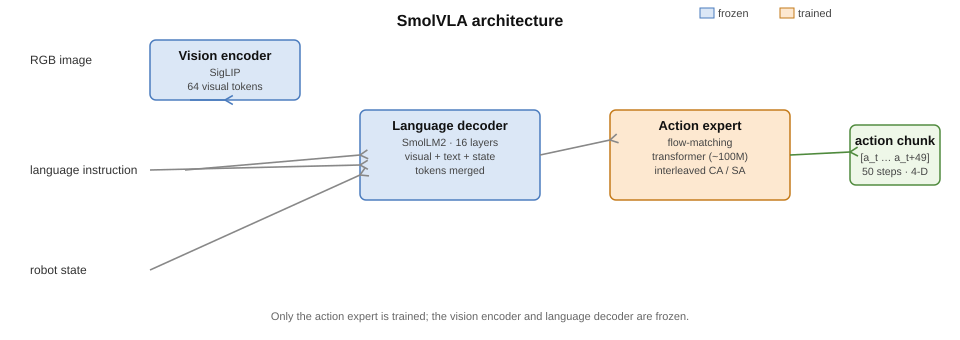

*SmolVLA architecture: the frozen vision encoder and language decoder feed a trained action expert that outputs an action chunk with flow matching. For the original diagram, see Figure 1 of the paper (arXiv:2506.01844).*

## Training configuration

```bash
lerobot-train \
  --policy.type=smolvla \
  --policy.load_vlm_weights=true \
  --dataset.repo_id=lerobot/metaworld_mt50 \
  --batch_size=32 --steps=10000 \
  --save_freq=2000 --log_freq=100 \
  --output_dir=./outputs/metaworld \
  --wandb.enable=false
```

Only the action expert receives gradients. Checkpoints are saved every 2000 steps with weights, optimizer and scheduler state, which allows resuming a run after an environment timeout.

### Training curve

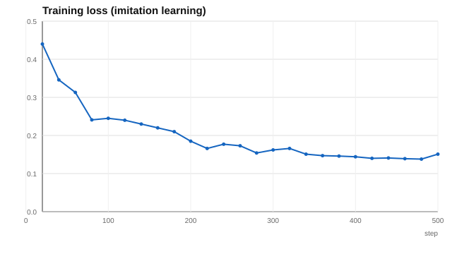

The loss drops quickly in the first few hundred steps and then plateaus, which is the expected behaviour for a frozen backbone with a small trained head. The training curves for the M1 (MT50) and M2 (4 tasks) runs are logged in their respective Kaggle runs.

## Results

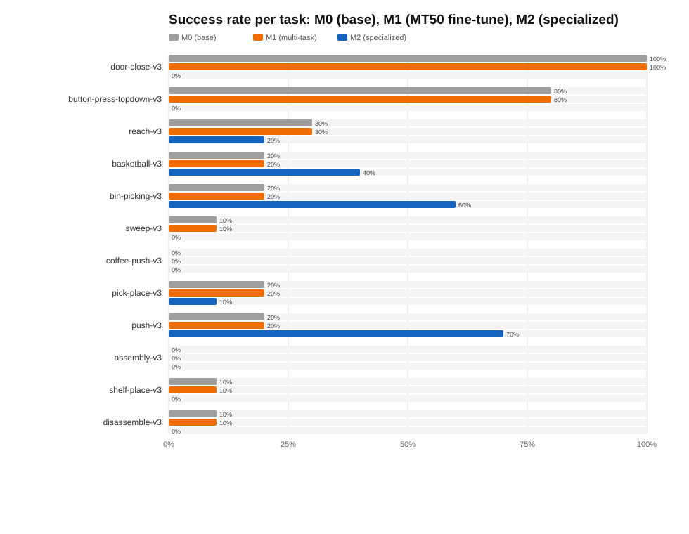

| Task | Difficulty | M0 | M1 | M2 |
|------|-----------|----|----|-----|
| door-close-v3 | easy | 100% | 100% | 0% |
| button-press-topdown-v3 | easy | 80% | 80% | 0% |
| reach-v3 | easy | 30% | 30% | 20% |
| basketball-v3 | medium | 20% | 20% | 40% |
| bin-picking-v3 | medium | 20% | 20% | 60% |
| sweep-v3 | medium | 10% | 10% | 0% |
| coffee-push-v3 | medium | 0% | 0% | 0% |
| pick-place-v3 | hard | 20% | 20% | 10% |
| push-v3 | hard | 20% | 20% | 70% |
| assembly-v3 | hard | 0% | 0% | 0% |
| shelf-place-v3 | very-hard | 10% | 10% | 0% |
| disassemble-v3 | very-hard | 10% | 10% | 0% |
| Mean | | about 27% | about 27% | about 17% |

Results are reported over 10 episodes per task. The 95% Wilson confidence interval of each task is available in the raw `eval_info.json` files.

## Model comparison

Each cell is one rollout: the first successful episode, or episode 0 when the model never succeeded on that task. The numbers are the success rate (M0 / M1 / M2). Tasks marked † are the four that M2 was fine-tuned on.

| Task (success rate: M0 / M1 / M2) | M0 (base) | M1 (multi-task) | M2 (specialized) |
|------------------------------------|-----------|-----------------|-------------------|
| door-close-v3 (100% / 100% / 0%) | 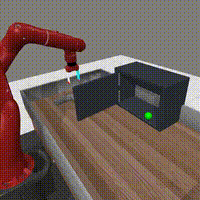 |  | 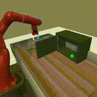 |
| button-press-topdown-v3 (80% / 80% / 0%) |  | 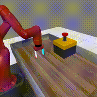 | 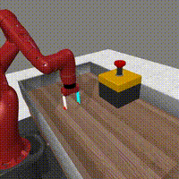 |
| reach-v3 (30% / 30% / 20%) |  |  | 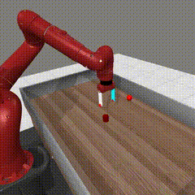 |
| † basketball-v3 (20% / 20% / 40%) |  |  | 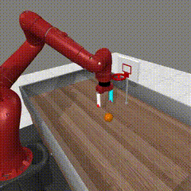 |
| † bin-picking-v3 (20% / 20% / 60%) |  |  | 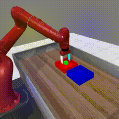 |
| sweep-v3 (10% / 10% / 0%) |  |  |  |
| coffee-push-v3 (0% / 0% / 0%) |  | 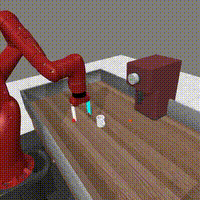 | 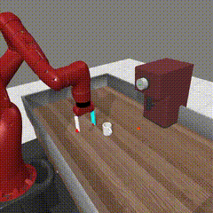 |
| † pick-place-v3 (20% / 20% / 10%) | 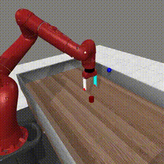 |  |  |
| † push-v3 (20% / 20% / 70%) |  |  |  |
| assembly-v3 (0% / 0% / 0%) | 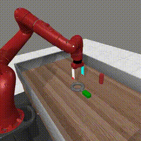 |  | 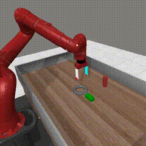 |
| shelf-place-v3 (10% / 10% / 0%) |  | 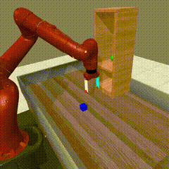 | 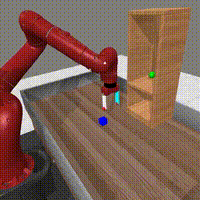 |
| disassemble-v3 (10% / 10% / 0%) | 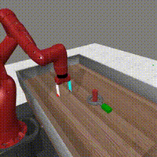 |  | 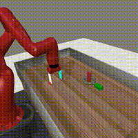 |

† = one of the four tasks M2 was fine-tuned on (basketball, bin-picking, pick-place, push).

## Findings

**The pretrained base is already competent.** `lerobot/smolvla_base` is a generalist VLA pretrained on community manipulation data. Without any fine-tuning it scores 100% on door-close and 80% on button-press.

**A short multi-task fine-tune does not change behaviour.** M1 is statistically identical to M0. A 10,000-step run with batch size 32 corresponds to roughly 0.25 epoch over MT50, which is not enough to move a 450M parameter model. The training loss decreased from 0.44 to 0.14, but the observable success rate did not change.

**Specialization improves trained tasks and causes catastrophic forgetting elsewhere.** M2 was fine-tuned on four tasks (basketball, bin-picking, pick-place, push). On those tasks the success rate increased substantially (push +50, bin-picking +40, basketball +20 percentage points), while every task that was not trained on dropped to zero or near zero (door-close from 100% to 0%, button-press from 80% to 0%). The overall mean therefore falls from about 27% to about 17%: specialization trades breadth for depth. Pick-place is an exception (20% to 10%), which is within the confidence interval of a 10-episode evaluation and should be treated as noise.

## Discussion and conclusion

The central finding is not a new phenomenon. Catastrophic forgetting, the loss of previously learned behaviour when a network is fine-tuned on new data, is one of the oldest known failure modes of neural networks (McCloskey and Cohen, 1989; Goodfellow et al., 2013), and regularisation methods such as Elastic Weight Consolidation were proposed specifically to mitigate it (Kirkpatrick et al., 2017). The pattern observed here, a broad fine-tune that changes nothing and a specialized fine-tune that improves its targets while destroying the rest, is consistent with what the VLA literature reports when models are fine-tuned on narrow data.

Two observations are worth stating explicitly:

1. The pretrained base is strong. A generalist VLA already solves the easy tasks and a fraction of the harder ones. Fine-tuning changes behaviour only with enough data and compute.
2. Data coverage dominates. The success of M2 is concentrated exactly on the four tasks present in its training set, and everything absent from that set regressed.

This has a direct practical implication for anyone deploying a fine-tuned VLA: either the evaluation set must be covered by the training set, or the generalist checkpoint must be kept alongside the specialized one. The mitigation menu (data mixing, LoRA, regularisation, multi-task training) is standard but costs compute.

What this work adds is a small, reproducible, and honest measurement: the same model, the same twelve tasks, three training regimes, and the exact numbers. The limitation is compute. Ten thousand steps is a demonstration budget, and the conclusions should be read as a lower bound on what a full training run would achieve.

## Improvement directions

| Direction | Effort | Expected gain |
|-----------|--------|---------------|
| Train longer (10k to 50k or 100k steps) | about 5x compute | Main lever; 10k steps is roughly 0.25 epoch |
| Unfreeze the last VLM layers | low | Adapts visual features to the new embodiment |
| Wider or deeper action expert | low | More capacity for the policy head |
| Use more VLM layers | low | More reasoning, slower inference |
| Additional or better data | high | Largest long-term gain |
| LoRA or PEFT on the VLM | low | Cheap domain adaptation |
| More evaluation episodes (10 to 50) | low | Tighter confidence intervals |

The main limitation is compute. A 10,000-step run is a demonstration budget rather than a research budget, and every direction above is a lever on that budget.

## Reproduce

```bash
# install LeRobot (pinned for reproducibility)
git clone https://github.com/huggingface/lerobot.git && cd lerobot
git checkout d3793b7e36522321c1c455f0dc4826db3793dceb
pip install -e ".[smolvla,dataset]"
pip install "metaworld==3.1.1" "mujoco==3.3.0"

# fine-tune
lerobot-train --policy.type=smolvla --policy.load_vlm_weights=true \
  --dataset.repo_id=lerobot/metaworld_mt50 --batch_size=32 --steps=10000 \
  --output_dir=./outputs/metaworld --wandb.enable=false

# evaluate in Meta-World
lerobot-eval --policy.path=./outputs/metaworld/checkpoints/010000/pretrained_model \
  --env.type=metaworld --env.task=pick-place-v3 --eval.batch_size=1 --eval.n_episodes=10
```

Notes from reproducing the pipeline:

- Meta-World task names use the `-v3` suffix, for example `pick-place-v3`.
- `metaworld==3.0.0` is incompatible with MuJoCo 3, so pin `metaworld==3.1.1` and `mujoco==3.3.0`.
- Fine-tuning from `--policy.path=lerobot/smolvla_base` fails on Meta-World because the base model expects a different camera and state layout. Use `--policy.type=smolvla --policy.load_vlm_weights=true` instead.
- Long runs can exceed a notebook session limit, so enable checkpointing and resume with `--resume=true --config_path=<checkpoint>/pretrained_model`.

## Repository layout

```
ros-vla-manip/
  README.md
  docs/        literature review, setup, architecture, training, pipeline
  vla/         fine-tuning and evaluation notebooks
  results/     metrics, success-rate plot, evaluation videos
  sim/         Gazebo and ROS worlds
  ros2_ws/     ROS 2 workspace
  docker/      reproducible container
  eval/        evaluation utilities
```

## Citations

- SmolVLA, Shukor et al., arXiv:2506.01844 (2025).
- LeRobot, Hugging Face, https://github.com/huggingface/lerobot
- Meta-World, Yu et al., CoRL 2019.
- MuJoCo, Todorov et al., IROS 2012.

## Acknowledgements

Developed with the assistance of DeepSeek (AI coding agent, deepseek-v4-pro), which contributed to the pipeline, experiments and documentation.

## License

MIT
